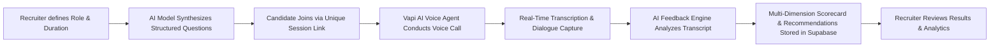

<div align="center">
  <h1>🎙️ RecruitAI</h1>
  <p><strong>Next-Gen Voice-Enabled AI Recruitment Platform</strong></p>
  <p>Automate candidate voice screenings, synthesize role-specific question sets with AI, and generate real-time multi-dimensional assessment scorecards.</p>
</div>

<p align="center">
  
  
  
  
  
  
</p>

---

## 📑 Table of Contents

- [Overview](#-overview)
- [System Architecture](#-system-architecture)
- [Key Features](#-key-features)
  - [For Recruiters](#for-recruiters)
  - [For Candidates](#for-candidates)
  - [For Platform Admins](#for-platform-admins)
- [Tech Stack](#-tech-stack)
- [Repository Structure](#-repository-structure)
- [Getting Started](#-getting-started)
  - [Prerequisites](#prerequisites)
  - [Installation](#installation)
  - [Environment Variables](#environment-variables)
  - [Database Schema (Supabase SQL)](#database-schema-supabase-sql)
- [AI Engine & Free-Tier Configuration](#-ai-engine--free-tier-configuration)
- [API Routes Reference](#-api-routes-reference)
- [Deployment](#-deployment)
- [Troubleshooting & FAQ](#-troubleshooting--faq)
- [License & Acknowledgments](#-license--acknowledgments)

---

## 💡 Overview

**RecruitAI** is a full-stack, enterprise-ready hiring workflow automation platform designed to eliminate early-stage screening fatigue. Instead of static text questionnaires or manually dialing dozens of applicants, recruiters can create an AI-powered voice interview in under 60 seconds.

Candidates enter an interactive browser session where a realistic **voice AI agent** conducts the interview, asks dynamic follow-ups, transcribes dialogue in real time, and produces structured analytical evaluations including numeric ratings and recommendation summaries.

---

## 📐 System Architecture



1. **Question Synthesis**: OpenAI / OpenRouter parses job descriptions and generates duration-calibrated technical, behavioral, and situational questions.
2. **Interactive Voice Session**: Vapi AI manages low-latency bidirectional speech using Deepgram (STT) and PlayHT (TTS).
3. **Dialogue Assessment**: On interview termination, the conversation transcript is audited across Technical Skills, Communication, Problem Solving, and Experience.
4. **Data Persistence**: Sessions, candidate profiles, and evaluation scorecards are stored in a relational PostgreSQL schema powered by Supabase.

---

## ✨ Key Features

### For Recruiters
- **Dynamic Question Synthesis**: Paste a job description to automatically formulate structured technical and behavioral interview tracks.
- **Credit-Based Campaign Allocation**: Flexible credit allocation per interview creation with unlimited candidate sessions per link.
- **Interactive Candidate Cards**: Shareable invite links, pre-filled email invitations, and live applicant tallies.
- **Detailed Evaluation Scorecards**: Review verbatim conversation transcripts, question-by-question candidate answers, overall scores out of 10, and recommendation tags.
- **Searchable Directories**: Full directory view of all scheduled and historical interview campaigns.

### For Candidates
- **Zero-Friction Interview Room**: Direct access via secure session links without mandatory software installation.
- **Natural Voice Interface**: Human-like conversational flow with live microphone volume meters and speech-state indicators.
- **Automated Resume Matching**: Candidate profile dashboard featuring resume/CV upload and status tracking.
- **Session History & Feedback**: Candidates can review historical sessions, AI ratings, and improvement opportunities.

### For Platform Admins
- **User Governance**: Audit user directories, track credit usage, and flag/ban malicious accounts.
- **Aggregate Analytics**: Monitor active role volumes, interview completion rates, and average assessment scores across the platform.
- **CSV Data Export**: One-click tabular export of candidates, scores, and interview performance metrics.

---

## 🛠 Tech Stack

### Core Frontend & UI
- **[Next.js 15 (App Router)](https://nextjs.org/)** — Server and client component architecture with optimized routing.
- **[React 18](https://react.dev/)** — Declarative UI composition.
- **[Tailwind CSS](https://tailwindcss.com/)** — Custom design tokens featuring an earthy sage & graphite ink aesthetic.
- **[Radix UI / shadcn/ui](https://ui.shadcn.com/)** — Accessible dialogs, tooltips, alert cards, and primitives.
- **[Lucide React](https://lucide.dev/)** — Clean, consistent iconography.

### Backend & Storage
- **[Supabase](https://supabase.com/)** — Managed PostgreSQL database with schema cache and REST client.
- **Supabase Auth** — Secure password and Google OAuth authentication flows.
- **Supabase Storage** — Candidate resume and document hosting.

### Voice & Machine Learning
- **[Vapi AI](https://vapi.ai/)** — Conversational voice agent orchestration.
- **[OpenRouter](https://openrouter.ai/)** — LLM gateway configured with automated zero-cost free-tier routing.
- **[Deepgram](https://deepgram.com/)** — High-accuracy real-time speech-to-text.
- **[PlayHT](https://play.ht/)** — Ultra-realistic low-latency text-to-speech.

---

## 📁 Repository Structure

```
AI-Recruitment-Agent/
├── app/
│   ├── (main)/
│   │   ├── recruiter/                   # Recruiter dashboard & campaign management
│   │   │   ├── dashboard/               # Metrics, credit counter, and recent pipelines
│   │   │   │   └── create-interview/    # Form builder & question synthesizer
│   │   │   ├── all-interview/           # Directory of all interviews
│   │   │   ├── scheduled-interview/     # Details & candidate feedback scorecards
│   │   │   ├── billing/                 # Credit packages & billing status
│   │   │   └── profile/                 # Profile & security settings
│   │   └── candidate/                   # Candidate portal
│   │       ├── dashboard/               # Applicant metrics & recent results
│   │       ├── interviews/              # Historical candidate interview log
│   │       ├── upload-cv/               # Resume upload & parser
│   │       └── profile/                 # Candidate credentials
│   ├── interview/
│   │   └── [interview_id]/              # Dynamic interview session
│   │       ├── start/                   # Voice call chamber with Vapi agent
│   │       └── completed/               # Submission confirmation screen
│   ├── admin/                           # Administrative console & audit tools
│   ├── api/
│   │   ├── ai-model/                    # AI question synthesis route
│   │   ├── ai-feedback/                 # Interview evaluation & grading route
│   │   └── admin/                       # User management & account actions
│   ├── layout.js                        # Root layout & providers
│   └── globals.css                      # Sage-ink color tokens & design rules
├── components/
│   ├── Logo.jsx                         # Responsive SVG vector logo component
│   ├── ui/                              # Radix UI design primitives
│   ├── login-form.jsx                   # Authentication login form
│   └── register-form.jsx                # Multi-role registration form
├── context/                             # Auth & user state context providers
├── services/
│   ├── Constants.jsx                    # Structured system prompts & options
│   └── supabaseClient.js                # Supabase SDK client initialization
├── public/                              # Vector & raster brand assets
├── supabase_fix.sql                     # Database migration script with FK relations
└── tailwind.config.mjs                  # Extended palette & typography config
```

---

## 🚀 Getting Started

### Prerequisites

- **Node.js**: `v18.17.0` or higher
- **npm** or **yarn**
- A **Supabase** project ([supabase.com](https://supabase.com/))
- An **OpenRouter** API key ([openrouter.ai](https://openrouter.ai/))
- A **Vapi AI** public API key ([vapi.ai](https://vapi.ai/))

### Installation

1. **Clone the repository:**
   ```bash
   git clone https://github.com/your-username/AI-Recruitment-Agent.git
   cd AI-Recruitment-Agent
   ```

2. **Install project dependencies:**
   ```bash
   npm install
   ```

3. **Configure environment variables:**
   Create a `.env.local` (or `.env`) file in the project root:
   ```env
   # Supabase Configuration
   NEXT_PUBLIC_SUPABASE_URL=https://your-project.supabase.co
   NEXT_PUBLIC_SUPABASE_ANON_KEY=your-supabase-anon-key

   # Voice Agent (Vapi AI)
   NEXT_PUBLIC_VAPI_API_KEY=your-vapi-public-api-key

   # OpenRouter LLM Gateway
   OPENROUTER_API_KEY=sk-or-v1-your-openrouter-key

   # Optional Custom Domain / Host (defaults to origin)
   NEXT_PUBLIC_HOST_URL=http://localhost:3000

   # Optional Model Override (defaults to auto-routed free models)
   # OPENROUTER_MODEL=openrouter/free
   ```

4. **Initialize database schema:**
   Run the SQL statements below in your [Supabase SQL Editor](https://app.supabase.com/).

5. **Start the local development server:**
   ```bash
   npm run dev
   ```

6. **Launch in your browser:**
   Navigate to [http://localhost:3000](http://localhost:3000).

---

## 🗄 Database Schema (Supabase SQL)

Copy and execute the following SQL script to create all required tables, constraints, foreign keys, and indexes:

```sql
-- 1. Users Table
CREATE TABLE IF NOT EXISTS users (
  id SERIAL PRIMARY KEY,
  email VARCHAR UNIQUE NOT NULL,
  name VARCHAR,
  role VARCHAR DEFAULT 'candidate' CHECK (role IN ('recruiter', 'candidate', 'admin')),
  picture VARCHAR,
  credits INTEGER DEFAULT 3,
  cv_file_path VARCHAR,
  banned BOOLEAN DEFAULT FALSE,
  created_at TIMESTAMP WITH TIME ZONE DEFAULT NOW()
);

-- 2. Interviews Table
CREATE TABLE IF NOT EXISTS "Interviews" (
  id SERIAL PRIMARY KEY,
  interview_id VARCHAR UNIQUE NOT NULL,
  "userEmail" VARCHAR NOT NULL,
  "jobPosition" VARCHAR,
  "jobDescription" TEXT,
  duration VARCHAR,
  type VARCHAR,
  "questionList" JSONB,
  created_at TIMESTAMP WITH TIME ZONE DEFAULT NOW()
);

-- 3. Interview Results Table (with Foreign Key)
CREATE TABLE IF NOT EXISTS interview_results (
  id SERIAL PRIMARY KEY,
  fullname VARCHAR,
  email VARCHAR,
  interview_id VARCHAR NOT NULL,
  conversation_transcript JSONB,
  recommendations VARCHAR,
  completed_at TIMESTAMP WITH TIME ZONE DEFAULT NOW(),
  CONSTRAINT fk_interview_results_interview
    FOREIGN KEY (interview_id)
    REFERENCES "Interviews"(interview_id)
    ON DELETE CASCADE
);

-- 4. Helpful Indexes
CREATE INDEX IF NOT EXISTS idx_interviews_user_email ON "Interviews"("userEmail");
CREATE INDEX IF NOT EXISTS idx_interview_results_interview_id ON interview_results(interview_id);
CREATE INDEX IF NOT EXISTS idx_interview_results_email ON interview_results(email);

-- 5. Storage Buckets (cv-uploads & avatars)
INSERT INTO storage.buckets (id, name, public)
VALUES ('cv-uploads', 'cv-uploads', true), ('avatars', 'avatars', true)
ON CONFLICT (id) DO UPDATE SET public = true;

-- Storage Policies
CREATE POLICY "Allow public cv-uploads access" ON storage.objects FOR ALL TO public USING (bucket_id = 'cv-uploads') WITH CHECK (bucket_id = 'cv-uploads');
CREATE POLICY "Allow public avatars access" ON storage.objects FOR ALL TO public USING (bucket_id = 'avatars') WITH CHECK (bucket_id = 'avatars');
```

> [!TIP]
> If your database was created earlier without relational constraints, run [`supabase_fix.sql`](supabase_fix.sql) to add the `fk_interview_results_interview` foreign key without losing existing records.

---

## 🤖 AI Engine & Free-Tier Configuration

Both question generation and transcript grading leverage OpenRouter's zero-cost tier:

```javascript
// app/api/ai-model/route.jsx & app/api/ai-feedback/route.jsx
const MODELS_TO_TRY = [
  process.env.OPENROUTER_MODEL,
  "openrouter/free",                   // Automatically balances between available free models
  "liquid/lfm-2.5-2.6b:free",          // Fallback 1 ($0.00 / token)
  "nvidia/nemotron-3.5-lightning:free",// Fallback 2 ($0.00 / token)
].filter(Boolean);
```

- **Guaranteed \$0.00 Cost**: All models ending in `:free` and `openrouter/free` have `prompt: 0` and `completion: 0`.
- **Automatic Fallback Sequence**: If one free model is rate-limited, the system automatically tries the next model in the pool before throwing an error.

---

## 🔌 API Routes Reference

| Endpoint | Method | Description |
| :--- | :--- | :--- |
| `/api/ai-model` | `POST` | Generates a structured JSON question set based on job description, duration, and interview type. |
| `/api/ai-feedback` | `POST` | Evaluates a completed conversation transcript and returns multi-attribute ratings (1–10) and hiring recommendation. |
| `/api/admin/ban-user` | `POST` | Administrative endpoint to toggle ban status on a user account. |

---

## 🚢 Deployment

### Deploying on Vercel

1. Push your code to a GitHub repository.
2. Go to [Vercel](https://vercel.com/) and click **"Add New Project"**.
3. Import your repository.
4. Supply the Environment Variables (`NEXT_PUBLIC_SUPABASE_URL`, `NEXT_PUBLIC_SUPABASE_ANON_KEY`, `NEXT_PUBLIC_VAPI_API_KEY`, `OPENROUTER_API_KEY`).
5. Click **"Deploy"**.

---

## ❓ Troubleshooting & FAQ

<details>
<summary><strong>Q: Why did I see "Could not find a relationship between 'Interviews' and 'interview_results'"?</strong></summary>
<p>
Supabase/PostgREST requires an explicit PostgreSQL Foreign Key constraint to perform nested queries (<code>.select("*, interview_results(*)")</code>). The app now features resilient separate queries with in-memory relational mapping, and you can execute <a href="supabase_fix.sql"><code>supabase_fix.sql</code></a> in your Supabase editor to add the database constraint permanently.
</p>
</details>

<details>
<summary><strong>Q: Why was the AI returning "404 Model is unavailable for free"?</strong></summary>
<p>
OpenRouter occasionally retires individual model slugs (like <code>llama-3.3-70b-instruct:free</code>) to paid status. The codebase now uses <code>openrouter/free</code> with multiple fallbacks, so your app will automatically route to whichever free models are currently live.
</p>
</details>

<details>
<summary><strong>Q: What permissions does the voice interview require?</strong></summary>
<p>
Candidates must grant microphone permissions when prompted by their browser. Modern Chromium, Firefox, and Safari browsers over HTTPS (or localhost during development) support the Web Audio API required by Vapi AI.
</p>
</details>

---

## 📜 License & Acknowledgments

Distributed under the **MIT License**. See `LICENSE` for details.

Special thanks to the developer communities and engineering teams behind:
- [Next.js](https://nextjs.org/)
- [Supabase](https://supabase.com/)
- [Vapi AI](https://vapi.ai/)
- [OpenRouter](https://openrouter.ai/)
- [Tailwind CSS](https://tailwindcss.com/)
- [Lucide Icons](https://lucide.dev/)

<p align="center">
  Built with ❤️ for intelligent, equitable, and modern talent screening.
</p>
